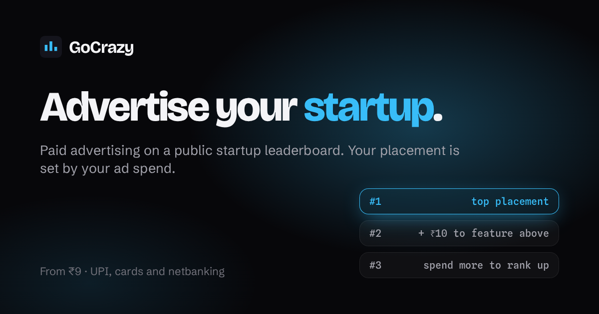
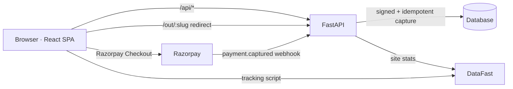

<div align="center">



# GoCrazy

**A self-serve advertising platform for startups.** Businesses pay to feature their startup as a sponsored listing on a public directory. Listings are placed by advertising spend: the more you spend, the higher your listing is featured. Every placement is clearly labelled as a paid advertisement, and the clicks each listing receives are reported transparently.

[](LICENSE)
[](CONTRIBUTING.md)


</div>

---

## Overview

GoCrazy is a public, ranked directory of startups where position is determined by advertising spend, much like a search ad auction. A founder submits their website, picks a category, pays in rupees through [Razorpay](https://razorpay.com), and their listing goes live. Spend accumulates over time, and paying more moves a listing higher. The result is a transparent marketplace for startup visibility: everyone can see what a placement costs and how much traffic it earns.

The project is a production-grade, full-stack application: a React single-page app and a FastAPI backend, deployed together on Vercel, with payments, analytics, and a clean, accessible, dark-themed UI.

## Features

- **Self-serve sponsored listings** — submit a URL or `@handle`, choose a category, and go live in seconds.
- **Spend-based placement** — a listing's position is the sum of its advertising spend; pay again any time to rank higher.
- **Multiple boards** — All-time, Today (resets at midnight IST), a daily archive, per-category boards, and a discounts board.
- **Razorpay checkout** — UPI, cards, netbanking and wallets, with a signed, idempotent `payment.captured` webhook and a server-verified capture flow.
- **Transparent analytics** — site traffic measured independently by [DataFast](https://datafa.st); per-listing clicks counted via a tagged redirect.
- **Polished, accessible UI** — dark theme, a cursor-reactive WebGL neon-tubes hero, motion that respects `prefers-reduced-motion`, and WCAG-compliant contrast.
- **Built to deploy** — one Vercel project serves the static frontend and the Python API on a single domain, so there is no CORS and the webhook lives on the brand domain.

## Tech stack

| Layer | Technologies |
| --- | --- |
| **Frontend** | React 19, Vite, TypeScript, Tailwind CSS v4, `motion`, lucide-react, React Router, three.js |
| **Backend** | Python 3.12, FastAPI, SQLAlchemy 2, Pydantic |
| **Database** | SQLite (local), Postgres / libSQL (production) |
| **Payments** | Razorpay (Orders API, Checkout.js, webhooks) |
| **Analytics** | DataFast (tracking script + server-side API) |
| **Hosting** | Vercel (static build + Python serverless function) |

## Architecture



- **One domain, two halves.** On Vercel, `/api/*`, `/out/*` and `/webhooks/*` are rewritten to a Python serverless function; everything else is served from the static React build.
- **Money is an append-only ledger.** A listing's rank is derived as `SUM(payments)`, never cached. Every capture is recorded once, idempotently, and reached through a single code path shared by the checkout callback and the webhook.
- **Integrity first.** Razorpay signatures are verified on the raw request body, amounts are integer paise, and a listing goes live only after a payment is confirmed.

## Getting started

### Prerequisites

- [Node.js](https://nodejs.org) 20+ and [pnpm](https://pnpm.io)
- [Python](https://www.python.org) 3.12+ and [uv](https://github.com/astral-sh/uv)

### 1. Backend

```bash
cd backend
cp .env.example .env         # fill in keys as needed; blank keys enable a local test checkout
uv run uvicorn app.main:app --reload --port 8000
```

### 2. Frontend

```bash
cd frontend
pnpm install
pnpm dev                     # http://localhost:5173 (proxies /api, /out, /webhooks to :8000)
```

The database starts empty apart from its categories. With no Razorpay keys set, local payments use a test checkout that charges nothing; this path is disabled in production.

## Configuration

All settings are environment variables, documented with sensible defaults in [`backend/.env.example`](backend/.env.example). Nothing is sent to the browser except the public Razorpay key id and the public DataFast website id.

| Variable | Purpose |
| --- | --- |
| `DATABASE_URL` | Database connection string (SQLite locally; Postgres/libSQL in production) |
| `RAZORPAY_KEY_ID` / `RAZORPAY_KEY_SECRET` | Razorpay API keys |
| `RAZORPAY_WEBHOOK_SECRET` | Secret used to verify webhook signatures |
| `DATAFAST_API_KEY` / `DATAFAST_WEBSITE_ID` | DataFast analytics |
| `BUSINESS_NAME`, `CONTACT_EMAIL`, `BUSINESS_ADDRESS` | Shown on the Contact and legal pages |

## Testing

```bash
cd backend && uv run pytest -q         # backend unit + API tests
cd frontend && pnpm build              # type-check and production build
```

## Deployment

The app deploys to [Vercel](https://vercel.com) as a single project. Connect a Postgres (or libSQL) database, set the environment variables above in the project settings, import the repository, and point your Razorpay webhook at `https://<your-domain>/webhooks/razorpay` for the `payment.captured` event.

## Project structure

```
.
├── api/            # Vercel Python entrypoint (exposes the FastAPI app)
├── backend/        # FastAPI app: routes, pricing, ledger, Razorpay & DataFast clients
│   └── app/
├── frontend/       # React + Vite single-page app
│   └── src/
├── vercel.json     # Routing, headers and function config
└── README.md
```

## Contributing

Contributions are welcome. Please read [CONTRIBUTING.md](CONTRIBUTING.md) for the development workflow, coding conventions, and how to open a pull request. By participating you agree to the [Code of Conduct](CODE_OF_CONDUCT.md).

## License

Released under the [MIT License](LICENSE).
